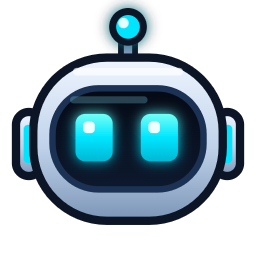

<p align="center"></p>

<h1 align="center">LumaDock</h1>
<p align="center"><b>A Dynamic Island for Windows with native AI monitoring and desktop companion.</b><br>
Robo monitors Claude Code, ChatGPT, Claude, and Codex, requests one-click permissions, and alerts you when tasks finish.</p>

<p align="center">
  <b>🧪 Public Beta</b> · Windows 10 & 11 · Free & Open Source<br>
  <a href="README.tr.md">🇹🇷 Türkçe Dokümantasyon</a>
</p>

---

## Overview

LumaDock brings a responsive, fluid **Dynamic Island** experience to Windows 10 and 11. Powered by native Windows UI Automation and local hooks, LumaDock lets you supervise your local AI coding agents and LLM sessions without stealing focus or requiring complex API configurations.

### Key Highlights

| Feature | Description |
| --- | --- |
| **Live AI Monitoring** | Tracks Claude Code and Codex execution in real time: active file reads, edits, and terminal commands. Island glows with custom status colors (busy, done, error). |
| **Zero-Config Web AI Tracking** | Uses native Windows UI Automation to observe ChatGPT and Claude web/desktop tabs. Traffic-light indicator shows generation state and questions. |
| **One-Click Approvals** | Directly approve or deny sensitive CLI tool actions (e.g. `npm install`, shell executions) straight from the island. |
| **Robo Buddy & Fix-It** | Drag Robo over any window or error message. Robo captures screen context, analyzes issues with your connected AI, and types verified fixes with permission. |
| **Rate Limit Ring** | Visual ring display for Anthropic Claude 5-hour quota and session usage. |
| **Integrated Productivity Apps** | Spotify playback controller with device switcher, Pomodoro focus timer, clipboard history manager, and quick notepad. |
| **Dedicated Settings App** | Standalone settings suite with live mascot preview, light/dark themes, custom sound packs, and outfit customization. |

---

## Quick Start (Pre-built)

1. Download **`LumaDock-Windows.zip`** from [Releases](../../releases/latest).
2. Extract the archive to your desired location (e.g., `Documents\LumaDock`).
3. Run **`LumaDock.exe`**.
4. *(If SmartScreen appears, click **More info → Run anyway**).*

### Shortcuts & Control

* **`Ctrl + Alt + T`**: Toggle Dynamic Island expand / collapse.
* **`Ctrl + Alt + 1..6`**: Direct shortcut to mini-apps (Music, Focus, Clipboard, Notes, etc.).
* **System Tray**: Right-click Robo in the taskbar tray for autostart settings and quick access.
* **`CHECK-WINDOWS.cmd`**: Validates native Windows UI Automation accessibility status for active AI windows.

---

## Development & Building

### Prerequisites

* [Node.js](https://nodejs.org) (v18+ recommended)
* Windows 10 or 11 with PowerShell 5.1+

### Local Setup

```powershell
# Clone the repository
git clone https://github.com/WhoIsMrSentry/LumaDock.git
cd LumaDock

# Install dependencies
npm ci

# Run test suite (26 native and mock integration tests)
npm test

# Launch LumaDock in development mode
npm start
```

### Optional Codex Integration

For optional OpenAI Codex capabilities:
```powershell
npm install @openai/codex --include=optional
```

### Running Verification Tests

```powershell
npm test
```

To test the Windows UI Automation accessibility bridge directly:
```powershell
npm run check:windows
```

---

## Privacy First

LumaDock operates entirely on your local machine:
* No external telemetry or cloud tracking account required.
* Claude Code and terminal agent monitoring operates purely over local loopback IPC/HTTP hooks.
* Browser chat monitoring reads locally via Microsoft Windows UI Automation (`System.Windows.Automation`) without passing browser credentials or session cookies.

---

## License

MIT License. Developed and maintained by [SentryCoderDev](https://github.com/WhoIsMrSentry).
