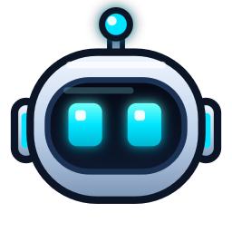

<p align="center"></p>

<h1 align="center">LumaDock</h1>
<p align="center"><b>Windows için yerel yapay zeka monitörüne ve masaüstü asistanına sahip Dynamic Island.</b><br>
Robo; Claude Code, ChatGPT, Claude ve Codex oturumlarını izler, tek tıkla onay ister ve işlemler bittiğinde size haber verir.</p>

<p align="center">
  <b>🧪 Açık Beta</b> · Windows 10 & 11 · macOS (Apple Silicon & Intel) · Ücretsiz ve Açık Kaynak<br>
  <a href="README.md">🇬🇧 English Documentation</a>
</p>

---

## Genel Bakış

LumaDock, Apple'ın popüler "Dynamic Island" (Dinamik Ada) deneyimini Windows 10 ve 11 masaüstünüze getirir. Yerel Windows UI Otomasyonu ve sistem kancalarıyla (hooks) güçlendirilen LumaDock, dikkatinizi dağıtmadan ve karmaşık API anahtarlarına gerek kalmadan arka plandaki yapay zeka ajanlarınızı ve sohbetlerinizi yönetmenizi sağlar.

### Öne Çıkan Özellikler

| Özellik | Açıklama |
| --- | --- |
| **Canlı Yapay Zeka Takibi** | Terminalde çalışan Claude Code ve Codex işlemlerini (okunan dosyalar, yapılan düzenlemeler, çalıştırılan komutlar) anlık olarak adada gösterir. Ada; meşgul, tamamlandı ve hata durumlarına göre parlar. |
| **Sıfır Yapılandırma ile Web AI Monitörü** | ChatGPT ve Claude sekmelerini yerel Windows UI Otomasyonu ile izler. Tarayıcı eklentisi veya API anahtarı gerekmez. Trafik ışığı göstergesi üretim durumunu ve soruları bildirir. |
| **Tek Tıkla Komut Onayı** | Claude Code CLI bir komut çalıştırmak istediğinde (`npm install` vb.) doğrudan Dynamic Island üzerinden "Onayla" veya "Reddet" diyebilirsiniz. |
| **Robo Buddy & "Benim İçin Düzelt"** | Robo maskotunu ekrandaki herhangi bir pencerenin veya hata mesajının üzerine sürükleyin. Robo ekran bağlamını inceler, bağlı AI ile hatayı tespit eder ve onayınızla kodu doğrudan dosyaya yazar. |
| **Kota Göstergesi** | Anthropic Claude 5 saatlik kullanım kotasını dairesel bir ilerleme halkası olarak canlı takip eder. |
| **Dahili Masaüstü Araçları** | Spotify müzik kontrolcüsü ve cihaz seçici, Pomodoro odak sayacı, pano (clipboard) geçmişi yöneticisi ve hızlı not defteri. |
| **Özel Ayarlar Uygulaması** | Canlı maskot önizlemesi, açık/koyu tema seçeneği, özel ses paketleri ve kostüm dolabına sahip bağımsız ayarlar menüsü. |

---

## Hızlı Başlangıç

### Windows
1. [Releases](../../releases/latest) sayfasından **`LumaDock-Setup-1.3.0-beta.1-x64.exe`** (kurulum) veya **`LumaDock-1.3.0-beta.1-win-x64.zip`** (taşınabilir) dosyasını indirin.
2. Kurulumu çalıştırın ya da arşivi çıkartıp **`LumaDock.exe`** dosyasını başlatın.
3. *(Windows SmartScreen uyarısı çıkarsa **Ek bilgi → Yine de çalıştır** seçeneğine tıklayın).*

### macOS
1. [Releases](../../releases/latest) sayfasından **`LumaDock-1.3.0-beta.1-mac-arm64.dmg`** (Apple Silicon) veya **`LumaDock-1.3.0-beta.1-mac-x64.dmg`** (Intel) dosyasını indirin.
2. **`LumaDock`** uygulamasını **Applications (Uygulamalar)** klasörüne sürükleyin.
3. *(İmzasız derleme olduğu için ilk açılışta sağ tık → **Aç** yapın veya **Sistem Ayarları → Gizlilik ve Güvenlik** altından izin verin).*

### Kısayollar ve Kontroller

* **`Ctrl + Alt + T`**: Dynamic Island'ı açar / kapatır.
* **`Ctrl + Alt + 1..6`**: Dahili mini uygulamalara doğrudan geçiş yapar (Müzik, Odak, Pano, Notlar vb.).
* **Sistem Tepsisi (Tray)**: Görev çubuğunun sağ altındaki Robo simgesine sağ tıklayarak başlangıçta çalıştırma ayarını yapabilirsiniz.
* **`CHECK-WINDOWS.cmd`**: Açık olan yapay zeka pencerelerinin Windows UI Otomasyon erişilebilirliğini doğrular.

---

## Geliştirme ve Kaynak Koddan Çalıştırma

### Gereksinimler

* [Node.js](https://nodejs.org) (v18 veya üzeri önerilir)
* Windows 10 veya 11 (PowerShell 5.1+)

### Yerel Kurulum

```powershell
# Depoyu klonlayın
git clone https://github.com/WhoIsMrSentry/LumaDock.git
cd LumaDock

# Bağımlılıkları yükleyin
npm ci

# Testleri çalıştırın (26 adet birim ve entegrasyon testi)
npm test

# LumaDock'u geliştirici modunda başlatın
npm start
```

### İsteğe Bağlı Codex Desteği

OpenAI Codex entegrasyonunu etkinleştirmek için:
```powershell
npm install @openai/codex --include=optional
```

### Testleri Çalıştırma

```powershell
npm test
```

Windows UI Otomasyon köprüsünü doğrudan test etmek için:
```powershell
npm run check:windows
```

---

## Gizlilik Odaklı Mimari

LumaDock tamamen yerel bilgisayarınızda çalışır:
* Harici bir sunucuya telemetri veya hesap verisi gönderilmez.
* Claude Code ve terminal izleme mekanizmaları yalnızca yerel `localhost` soketleri üzerinden haberleşir.
* Tarayıcı monitörü, tarayıcı şifrelerinize veya çerezlerinize dokunmadan doğrudan Microsoft Windows UI Automation (`System.Windows.Automation`) üzerinden yerel pencere öğelerini okur.

---

## Lisans

MIT Lisansı. [SentryCoderDev](https://github.com/WhoIsMrSentry) tarafından geliştirilmekte ve sürdürülmektedir.
